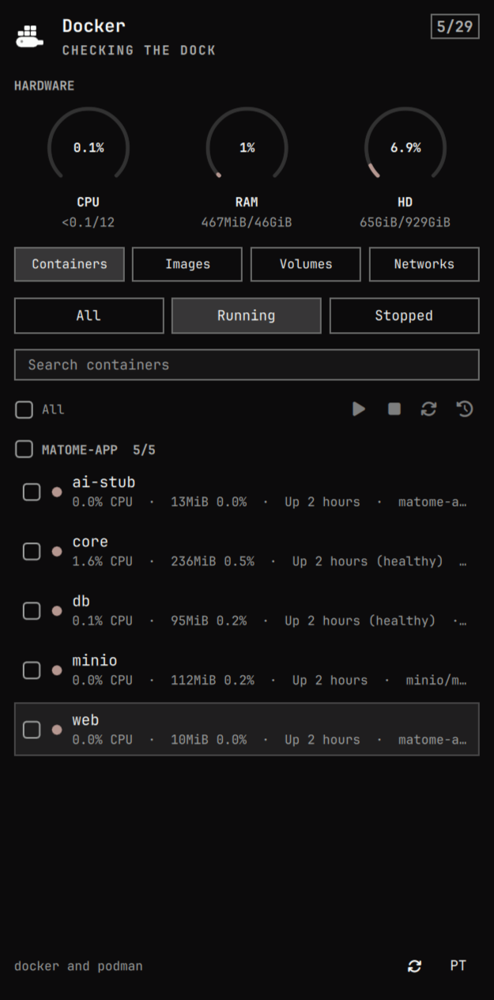

# Dockmarchy

Docker and Podman container status in the [Omarchy](https://omarchy.org) bar.

The bar widget is the engine logo. The panel lists containers, images,
volumes, and networks. Containers are grouped by compose project, with
hardware usage, search, bulk start/stop/restart, and logs. The other
tabs list engine resources and can remove selected items.



## Install

From a git remote:

```bash
omarchy plugin add <git-url>
omarchy plugin enable dockmarchy
```

While hacking on this checkout, copy it into the user plugin directory
(the shell refuses a symlink there):

```bash
rsync -a --delete --exclude .git --exclude test /home/howl/Projects/person/dockmarchy/ ~/.config/omarchy/plugins/dockmarchy/
omarchy-shell shell rescanPlugins
omarchy plugin enable dockmarchy --section right
```

`omarchy plugin disable dockmarchy` takes it off the bar;
`omarchy plugin remove dockmarchy` uninstalls it (don't remove a symlink you
still want).

## The bar

The widget is the Docker whale or the Podman seal, depending on which
engine answered. Hover shows the running count; after the panel has
opened once, it also includes last-seen CPU, RAM, and disk.
It turns urgent when something running is unhealthy, restarting, paused,
or dead. Right-click refreshes; middle-click opens logs for the first
visible container.

## The panel

Hardware is three small gauges — CPU, RAM, and disk — against the
machine totals, for example `12GiB/46GiB`. Disk is the Docker/Podman
footprint (`docker system df`) against the root filesystem.

The container list scrolls on its own. Hero, hardware, filters, search,
the command bar, and the footer stay put.

Containers are grouped by compose project. Filter by all / running /
stopped, then search by name, service, project, or image. Check rows (or
a whole compose group) and use the command bar to start, stop, restart,
or open logs. Logs open a new terminal per selected container on the
active workspace. Running containers follow with `-f`; stopped containers
show history and keep the window open.

Switch the top chips to Images, Volumes, or Networks. Those lists group
the same way (compose project, or repository for images). Select rows and
Remove from the command bar. Default networks (`bridge`, `host`, `none`)
are listed but not removed. Docker refuses a delete when the resource is
still in use; the panel shows that error.

Language defaults to English. Switch to Portuguese from the footer.

| Action | Mouse | Keyboard |
|--------|-------|----------|
| Open / close | Click the logo | `Esc` closes |
| Refresh | Right-click the logo, or the refresh icon | `r` |
| Filter | The three chips | `1` `2` `3` |
| Kind | Containers / Images / Volumes / Networks | `c` `i` `v` `n` |
| Search | The search field | `/` |
| Select | Checkbox or row | `Space`, `a` for all visible |
| Start / stop | Command bar | `s`, `x` |
| Restart | Command bar | `t` |
| Logs | Command bar | `l` |
| Remove | Command bar (images, volumes, networks) | `d` |
| Language | `PT` / `EN` | — |
| Move | Hover | arrows or `hjkl` |

Engine detection is automatic: Docker if the CLI is there, Podman if it is,
both when both answer. Force one in the widget settings (`Auto` / `Docker` /
`Podman`). Refresh interval defaults to 15 seconds. While the panel is
closed, only the container list is polled so the bar stays cheap;
hardware gauges and images/volumes/networks load when you open the panel.

## Development

```bash
node test/model-test.js     # parser, compose labels, grouping, i18n
omarchy plugin validate .   # manifest against the shell's schema
```

`Model.js` has no Qt in it, so the list engine runs in node. `Panel.qml`
only paints state.

---

MIT. See [LICENSE](LICENSE).
